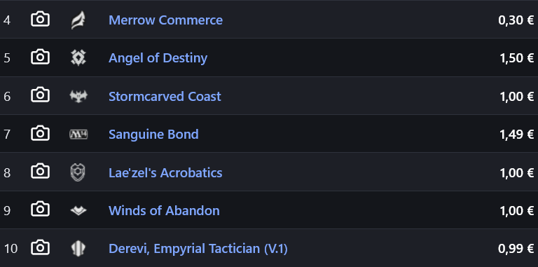
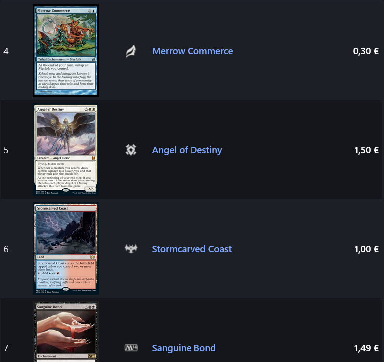
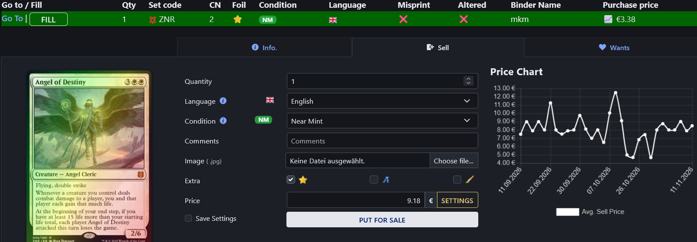
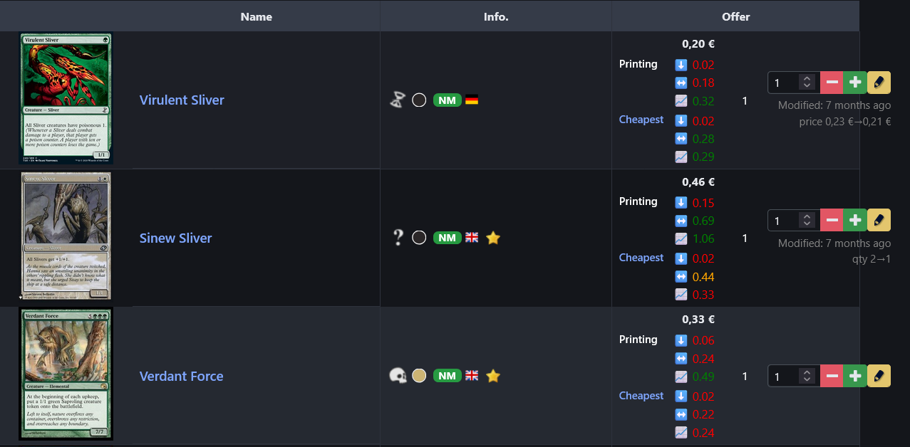
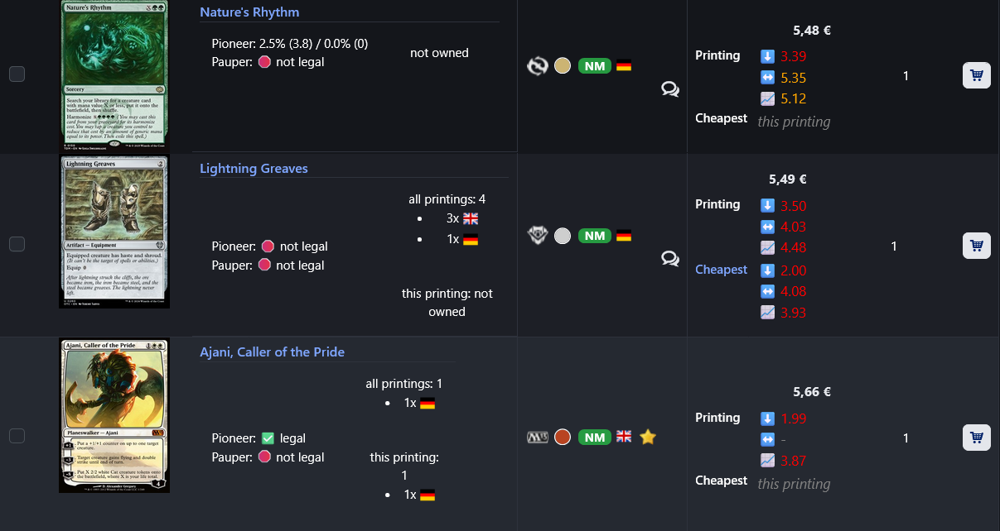
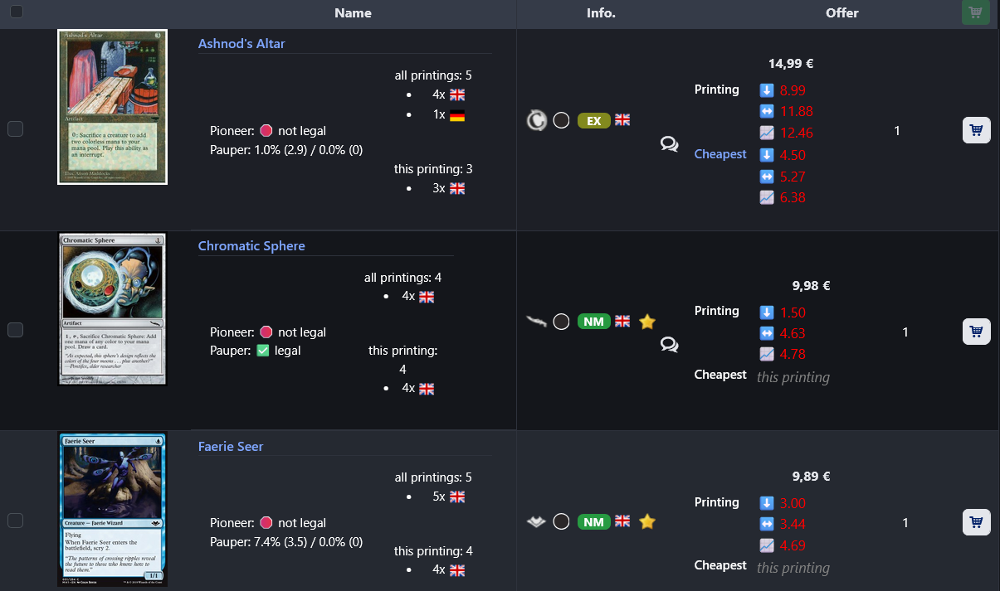
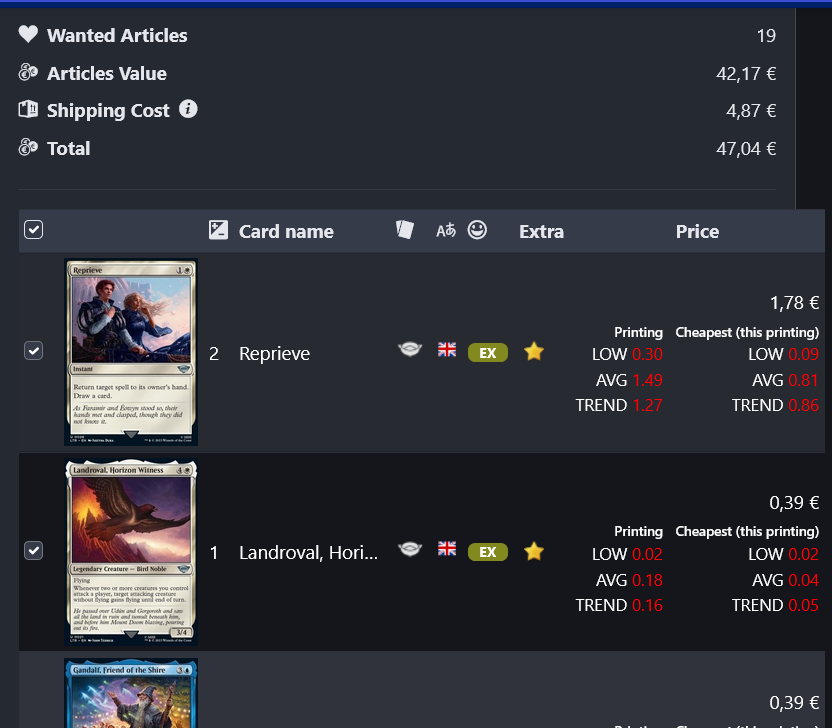
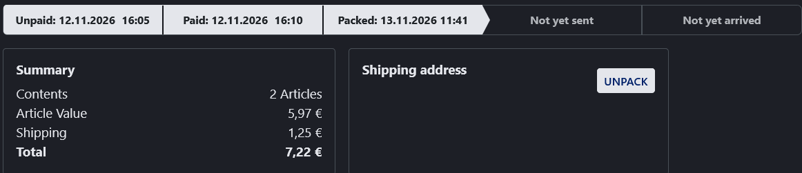
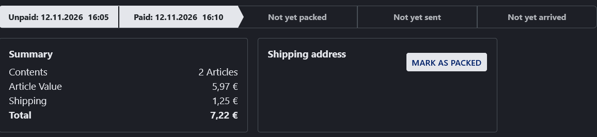
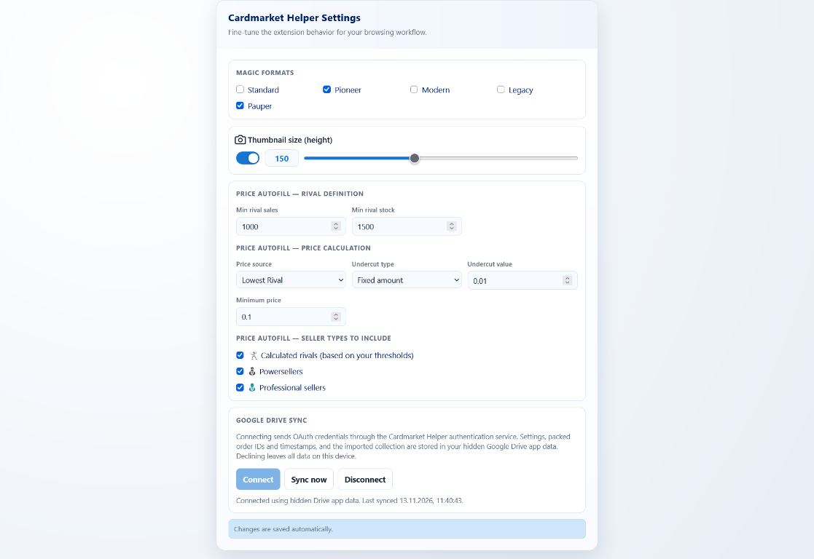

# User guide

Cardmarket Helper adds card images and tools for managing Magic collections, comparing prices, and tracking sales orders.

## Card previews

The add-on replaces camera placeholders with card images on product rows and other supported Cardmarket views.

## ManaBox collection and Singles helpers

Import a ManaBox CSV to load your collection into the current page. On Magic Singles pages, the collection overview shows owned printings and helps with listing cards.

The listing helper can:

- Fill quantity, language, condition, and foil state.
- Populate purchase price and sell-price guidance.
- Compare a card against LOW, AVG, and TREND market data.
- Show ownership and listing state for your printings.
- Add condition and language indicators.

Supported order exports also provide controls to open the export in ManaBox Viewer.

## Offers and price comparisons

Offer rows show printing-specific metrics and compare an offer with the relevant printing and the cheapest available option.

Comparisons include LOW, AVG, and TREND values, cheapest-printing context, colored price warnings, and optional Magic format filtering.

## Wants lists and Shopping Wizard

Wants list items and Shopping Wizard results can show price statistics, printing comparisons, and cheapest-printing context.

## Sales order reminders

Mark a sales order as packed and see its packed state in the order timeline. The state can be cleared later.

## Settings and sync

The settings screen includes thumbnail size, Magic format filters, price autofill behavior, and Google Drive sync.

