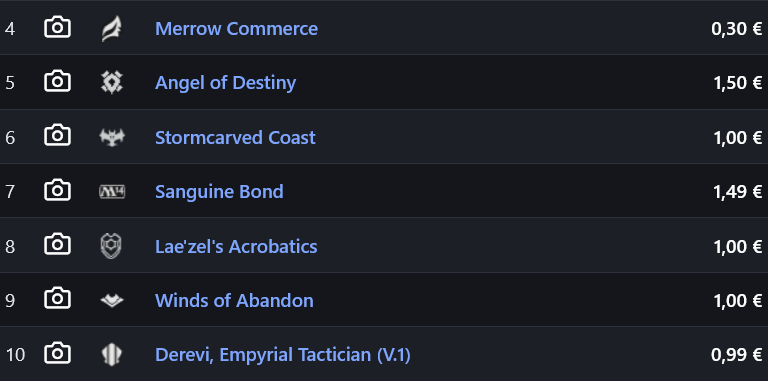
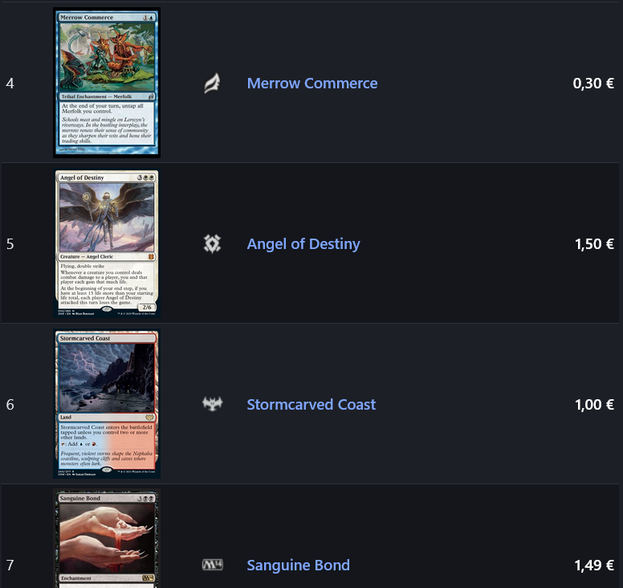
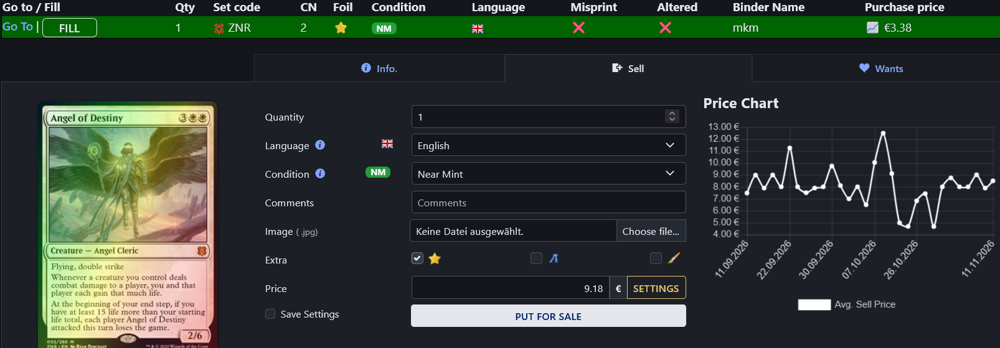
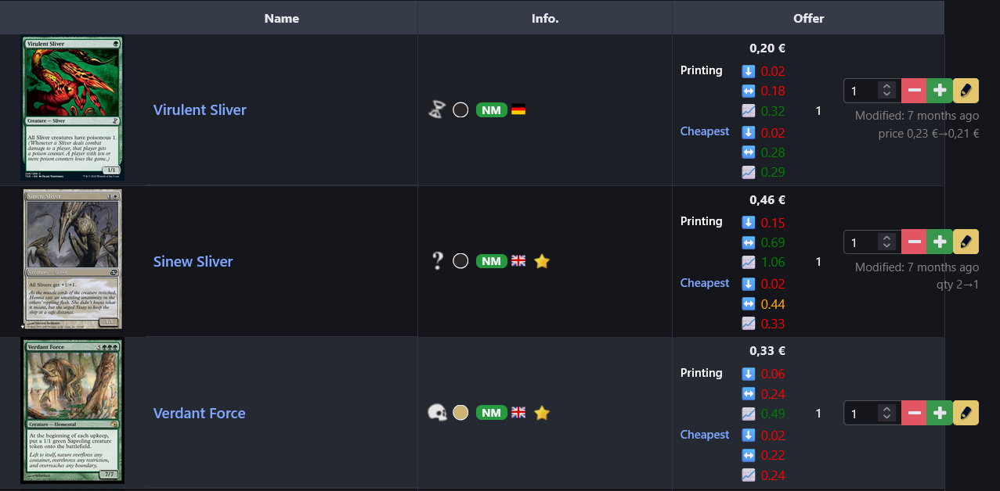
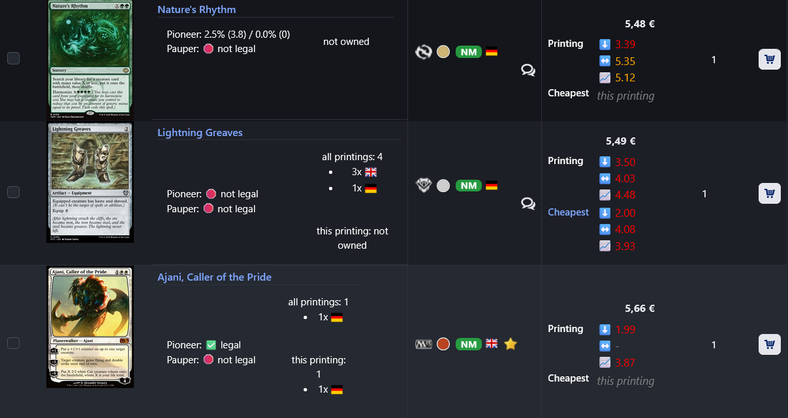
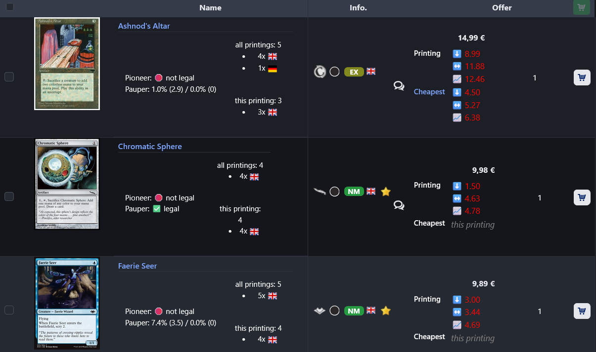
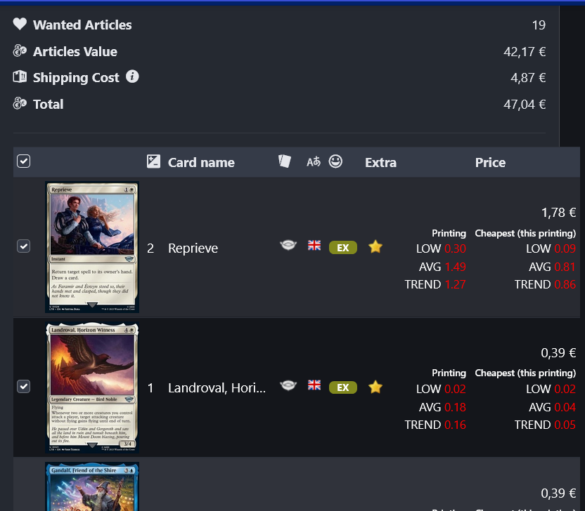
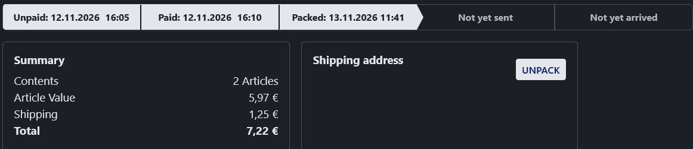
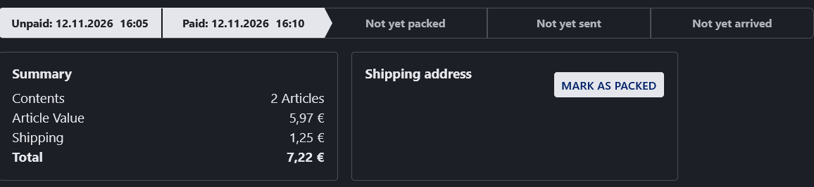
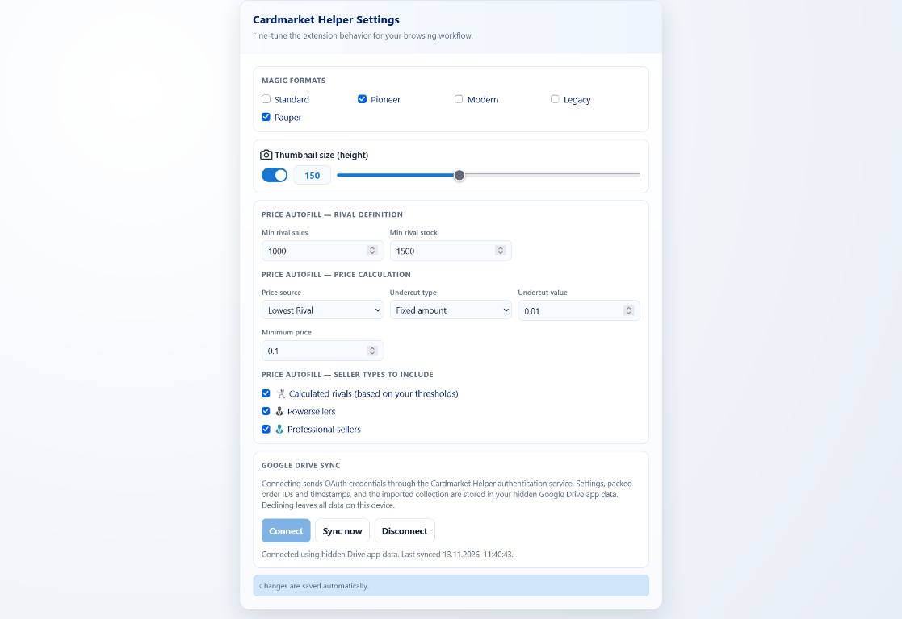

# Cardmarket Helper

https://addons.mozilla.org/en/firefox/addon/cardmarket-helper/

This Firefox-Addon is supposed to help in your everyday life with cardmarket.com

## Disclaimer

This add-on is not affiliated with, endorsed by, or in any way officially connected to Cardmarket. It is an independent, unofficial tool created to enhance the user experience on cardmarket.com

## License

This project is licensed under the **Creative Commons Attribution-NonCommercial 4.0 International (CC BY-NC 4.0)** license.

**You are free to:**
- Share, copy, and redistribute the material in any medium or format
- Remix, transform, and build upon the material

**Under these terms:**
- **Attribution** — You must give appropriate credit, provide a link to the license, and indicate if changes were made
- **NonCommercial** — You may not use the material for commercial purposes

For more information, see the [LICENSE](LICENSE) file or visit [https://creativecommons.org/licenses/by-nc/4.0/](https://creativecommons.org/licenses/by-nc/4.0/)

## [Release Notes / Changelog](CHANGELOG.md)

## Bug Reports / Feature Requests / Feedback

If you have any of those please feel free to submit them at https://github.com/SuppenNudel/cardmarket-helper/issues/new

## Development Setup

When loading this extension temporarily via `about:debugging`, Firefox MV3 treats `host_permissions` as optional. You must manually grant them:

1. Go to `about:addons`
2. Find "Cardmarket Helper"
3. Click on the extension name
4. Go to "Permissions" tab
5. Enable all listed permissions (Scryfall, Cardmarket downloads, GitHub)

**Note:** When the extension is signed and distributed through AMO, these permissions will be required at install time automatically.

## ManaBox Viewer target (for Orders export)

The **Open in ManaBox Viewer** button uses `config.manaboxViewerMode` from `browser.storage.local`:

- `local` (default): opens `http://localhost:8000/index.html`
- `hosted`: opens `https://suppennudel.github.io/manabox-viewer/`

## Inspirations

Some features of this add-on were inspired by existing add-ons. They are credited here:

### [Better Cardmarket MTG unofficial](https://chromewebstore.google.com/detail/better-cardmarket-mtg-uno/fplghokcfgbdedalpmbmjlafpagclbef)
- [IMPLEMENTED] Replace camera icons with preview images

### [Carmarket Format Filter](https://chromewebstore.google.com/detail/cardmarket-format-filter/okfobifncpmjgnccfacmfkdnkhjbiglp)
- [Source Code](https://github.com/Aeolic/cardmarket-filter)
- [IMPLEMENTED] Format filtering support

### [Cardmarket Companion](https://chromewebstore.google.com/detail/cardmarket-companion/mpbncolfefkegmaccdejhngjcjkjoaep)
- [IMPLEMENTED] Offer parsing and price autofill

## Current Features

### Thumbnail previews

The add-on replaces the placeholder camera icon with the actual card image on product rows and other Cardmarket views where thumbnails are shown.

### ManaBox collection import and singles page helpers

Import a ManaBox CSV and the extension loads the collection into the current page. On Magic Singles pages, this enables a collection-aware overview that shows which printings you own and helps automate the listing form.

The form helper supports:
- filling quantity, language, condition, and foil state
- auto-populating purchase price and sell price guidance
- comparing the current card against LOW, AVG, and TREND market data
- showing ownership and listing state for your printings
- adding condition and language indicators for faster decisions

ManaBox Viewer export controls are also available on supported order exports:

### Offers and price comparison

Offer rows are enhanced with price comparisons and printing-specific metrics. The extension shows the current offer in relation to the relevant printing and highlights the cheapest available option.

The price comparison includes:
- LOW, AVG, and TREND values
- cheapest-printing comparison
- colored price warnings based on the relative offer price
- optional Magic format filtering for legal/illegal offers

### Wants lists and Shopping Wizard

The extension adds price statistics to wants list items and Shopping Wizard results, including printing comparison and cheapest-printing context.

### Order tracking and packed-state reminders

On sales order pages, the extension can mark an order as packed and show that state in the order timeline. It can be cleared again later as needed.

### Settings and Google Drive sync

The settings screen lets you configure thumbnail size, Magic format filters, price autofill behavior, and Google Drive sync.

## Release Notes

See the full change history in [CHANGELOG.md](CHANGELOG.md).

## Historical notes

The project still contains some older notes and ideas that are not part of the current user-facing workflow. Those are kept mainly for historical context and are not required for normal use.

## Findings

### [Cardmarket Companion](https://chromewebstore.google.com/detail/cardmarket-companion/mpbncolfefkegmaccdejhngjcjkjoaep)
- Add-on with similar features
